Each of us see homeless nearly every day, even on the drive to work. And it makes one wonder, what are the statistics on homelessness? How many people live without houses?

Finding reasonable statistics on homelessness is at bet a difficult task for a myriad of reasons. Consider the difficulty of going around and asking the world, "do you live in a home?" How many people are going to say No, even if the answer is No. There is a negative stigma associated with living without, and sometimes it is just easier to say, "I'm okay, thanks for asking."

With the recent events in the United States, there is even more fear among those who may be homeless. If a human being identifies themselves as homeless, the person asking the question may have ulterior motives. The questions may persist, "Oh? No home? How are you getting money to live? Are you undocumented?" These somewhat benign questions such as "do you live in a home" can quickly go places that are simply not safe for those who are being demanded to answer the confrontation.

There have been a number of nationwide efforts to identify the homeless. The government creates "tiers of support" for counties that have chronic homeless and large numbers of homeless. In this, if a county can prove that they have "more homeless" than the next county, they may be positioned to have first rights to some grants. All in all, homeless counts are very complex, and there are quite a few reasons that they are pursued.

This article is going to point you to a number of tools to help understand the state of homelessness.

_The screen shots are captured and shared for educational purposes with attribution backlinks to the associated sites._

## By the numbers

There are well over 500,000 documented homeless people in the United States alone. The number rises exponentially when considering human beings living in substandard housing and living without what most of us would consider basic infrastructure such as running water and sewage control.

Many homeless live in encampments for safety, supplies, and companionship. According to the United States Interagency Council on Homelessness (USICH), more than 500,000 youth will experience homelessness lasting for more than one week.

## Data sources

There are several data sources available to help understand the the pervasiveness and effects of homelessness.

### United States Interagency Council on Homelessness

The USICH provides a comprehensive suite of [mapping tools](https://www.usich.gov/tools-for-action/map/#fn[]=1500&fn[]=2900&fn[]=6100&fn[]=10100&fn[]=14100) to help understand the pervasiveness of homelessness, and the tools allow the opportunity of exploring homelessness in different regions and by different filter criteria. The [2017 Annual Homeless Assessment Report to Congress](https://www.hudexchange.info/resources/documents/2017-AHAR-Part-1.pdf) provides an outline of the findings.

The following excerpts help to demonstrate the usability of the primary mapping tool.

<figure>

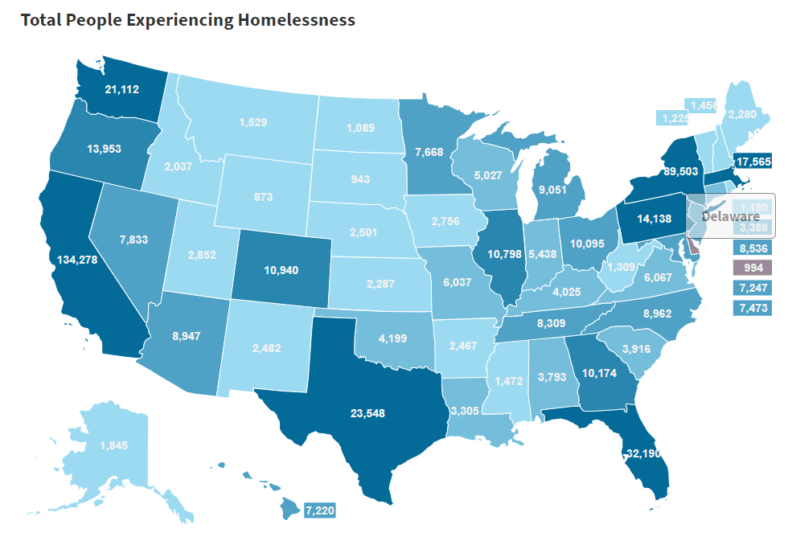

<figcaption>

Continuum of Care Homeless mapping 2017

</figcaption>

</figure>

The [2017 Total People Experiencing Homelessness](https://www.usich.gov/tools-for-action/map/#fn[]=3000&fn[]=9300&fn[]=17900&fn[]=26400&fn[]=39100&all_types=true&year=2017) mapping tool demonstrates an overall statistical homelessness mapping, and provides filtering opportunities.

One of the filtering sets includes the option of reviewing Public School Data. For example, one may be interested in identifying the total number of homeless public school students.

<figure>

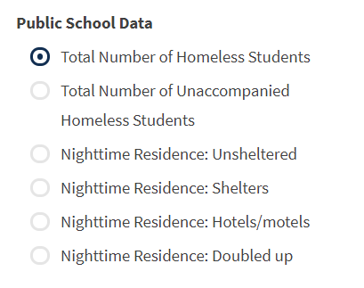

<figcaption>

Filtering options for Public School Data

</figcaption>

</figure>

<figure>

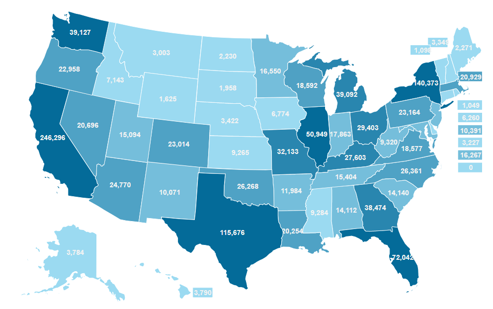

<figcaption>

2017 Total number of Homeless Public School Students

</figcaption>

</figure>

### United States data.gov data sources

[data.gov](https://catalog.data.gov/dataset?tags=homeless) is a United States government web index. At the time of this writing (March 2019), there are 33 listed data sources that provide information related to homelessness.

### US Department of Housing and Urban Development

United States Department of Housing and Urban Development provides a number of statistical models related to homelessness. One of the models is the [Point in time reference model](https://www.hudexchange.info/resource/5783/2018-ahar-part-1-pit-estimates-of-homelessness-in-the-us/).

[The 2018 Annual Homeless Assessment Report (AHAR) to Congress](https://www.hudexchange.info/resources/documents/2018-AHAR-Part-1.pdf) provides significant information on homelessness, including National, State, and Continuum of Care estimates on homelessness. The Continuums of Care focus on homelessness in the 50 largest cities in the United States.

HUD also provides a zoomable map that displays poverty concentrations in HUD Blockgroups.

<figure>

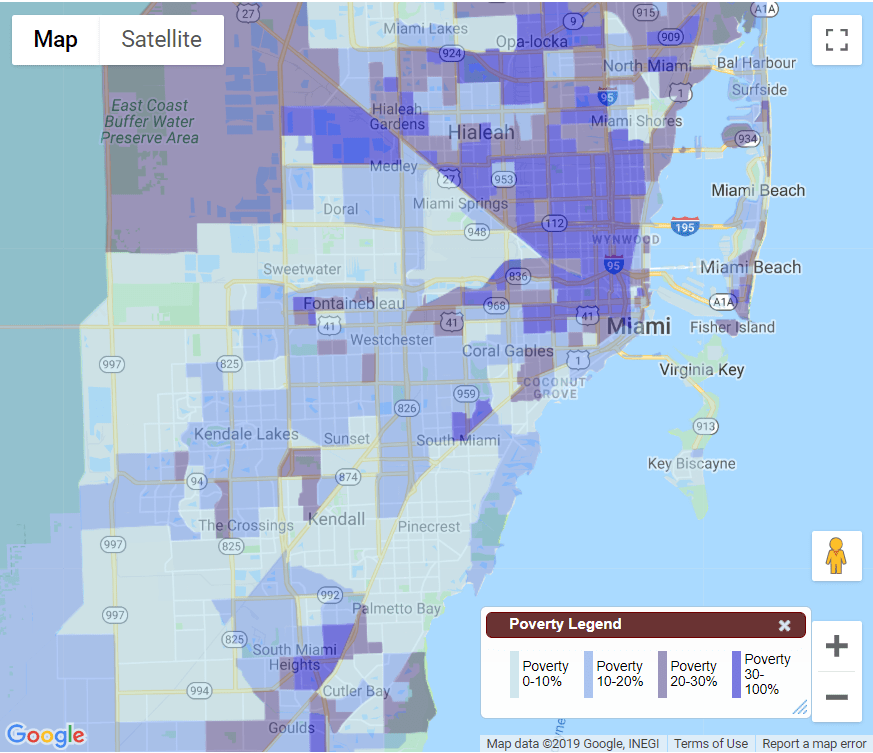

<figcaption>

HUD Poverty Heatzone Map, Miami-Dade County, Florida

</figcaption>

</figure>

HUD also releases data related to Qualified Census Tracts (QCTs) and Difficult Development Areas (DDAs). These data graphs can be viewed directly on the [HUD User](https://www.huduser.gov/portal/sadda/sadda_qct.html) web site.

<figure>

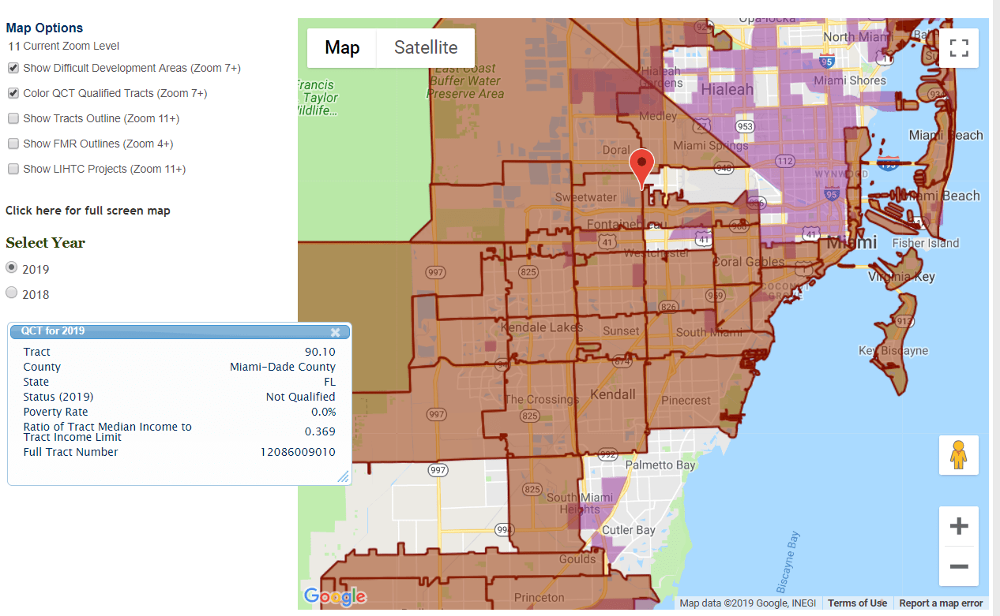

<figcaption>

HUDUser Qualified Census Tracts (QCTs) and Difficult Development Areas (DDAs)

</figcaption>

</figure>

### Office of Policy Development and Research

The [2018 Choice Neighborhood](https://www.huduser.gov/portal/maps/CN/home.html) page offers a zoomable map that provides a poverty Heat Zone.

<figure>

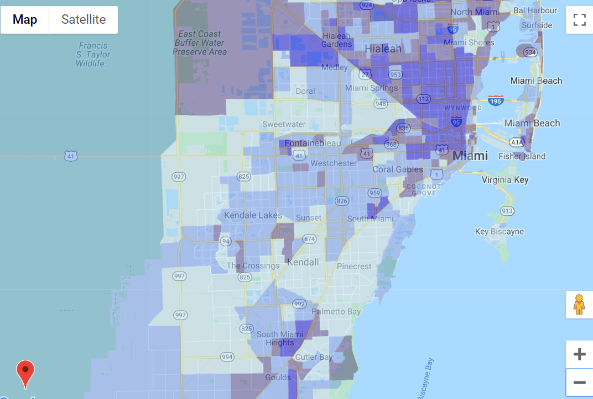

<figcaption>

Poverty heat zone Miami-Dade County, Florida

</figcaption>

</figure>

The map is pannable and zoomable. The system can also be searched by County or Address.

### Kidscount

[Kidscount](https://datacenter.kidscount.org/search/) provides family related statistical and mapping information. The data can be filtered by more than fifty different indicators including demographic, economic, education, and health related.

<figure>

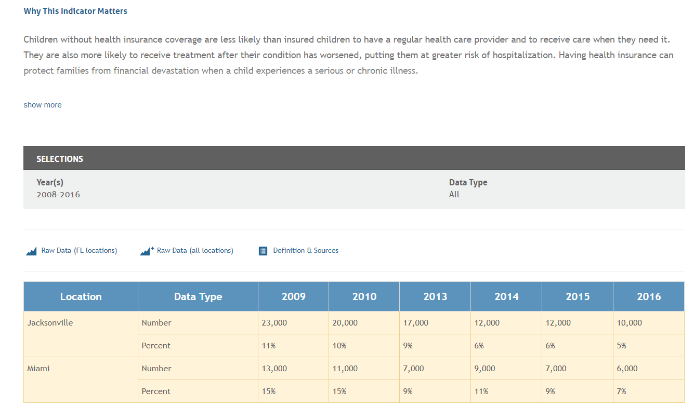

<figcaption>

Kidscount data set filtered by (1) Florida City, (2) children lacking healthcare insurance

</figcaption>

</figure>

### Homeless Analytics

The [Homeless Analytics](http://homelessnessanalytics.org/map/#) web site allows searching homeless data sets by a number of filter criteria.

<figure>

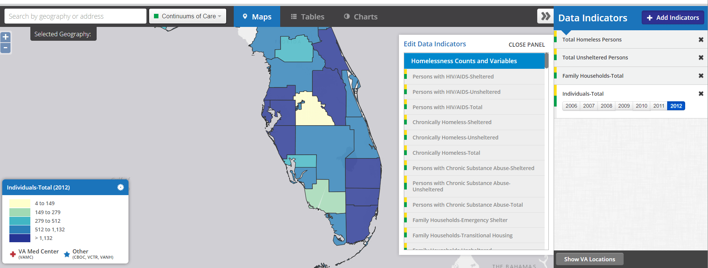

<figcaption>

Homeless Analytics search and filter page

</figcaption>

</figure>

Homeless Analytics also has a Forecasting engine with several available filters, such as "increase in unemployment rate."

<figure>

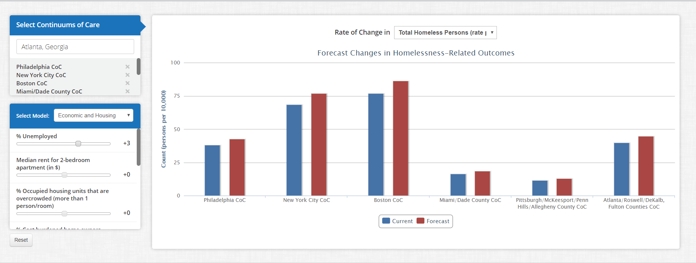

<figcaption>

Homeless Analytics Forecasting Engine

</figcaption>

</figure>

### Understanding Homelessness

The Understanding Homelessness web site represents homelessness by way of a heatmap.

<figure>

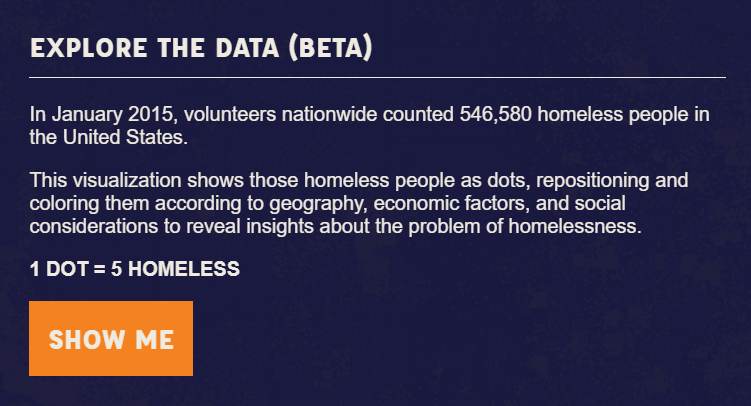

<figcaption>

Homelessness opening chart

</figcaption>

</figure>

While the data is visually stimulating, there doesn't appear to be a way to obtain the statistics per area, and the map is difficult to discern in anything other than a macro level.

<figure>

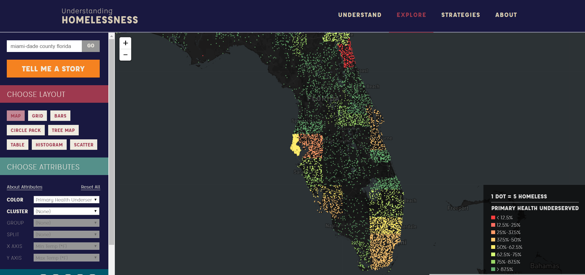

<figcaption>

Understanding homeless heat map

</figcaption>

</figure>

### National Alliance to End Homelessness

NAEH provides Point in Time graphs. Click on the county seat bubble to see more about that particular county.

<figure>

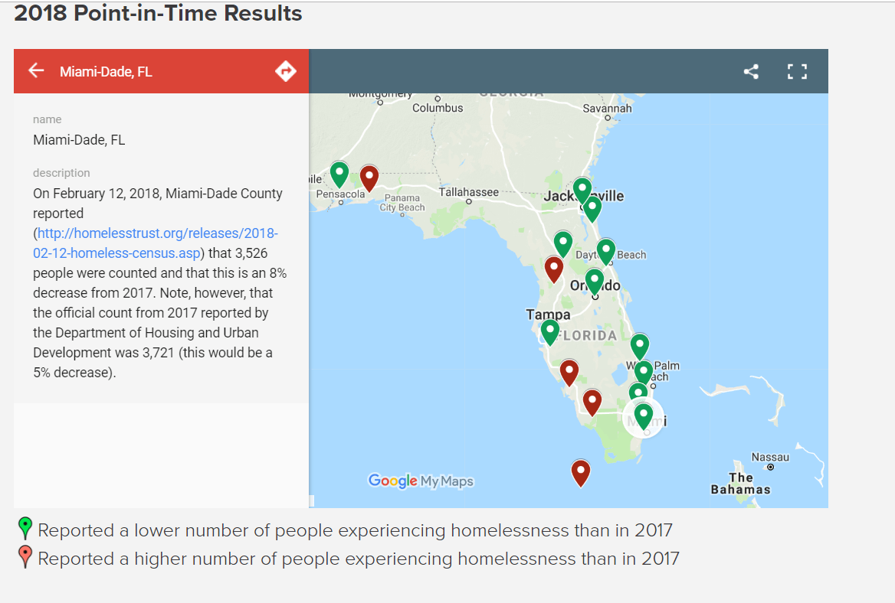

<figcaption>

Point in time graphs

</figcaption>

</figure>

## References

- https://catalog.data.gov/dataset?tags=homeless
- https://www.socialsolutions.com/blog/2016-homelessness-statistics/
- https://www.usich.gov/tools-for-action/map/#fn\[\]=1500&fn\[\]=2900&fn\[\]=6100&fn\[\]=10100&fn\[\]=14100
- "5 Troubling Statistics About Homelessness That You Should Know", https://www.huffingtonpost.com/entry/5-troubling-statistics-about-homelessness-that-you\_us\_5924473de4b0b28a33f62f92
- "Homeless people are among the most vulnerable groups in high-income countries", https://ourworldindata.org/homelessness
- "Homelessness in the United States", https://en.wikipedia.org/wiki/Homelessness\_in\_the\_United\_States
- "GLOBAL HOMELESSNESS STATISTICS", https://homelessworldcup.org/homelessness-statistics/
- "Mapping America's Intractable Homelessness Problem", https://www.citylab.com/equity/2017/04/map-america-homeless-crisis/522339/
